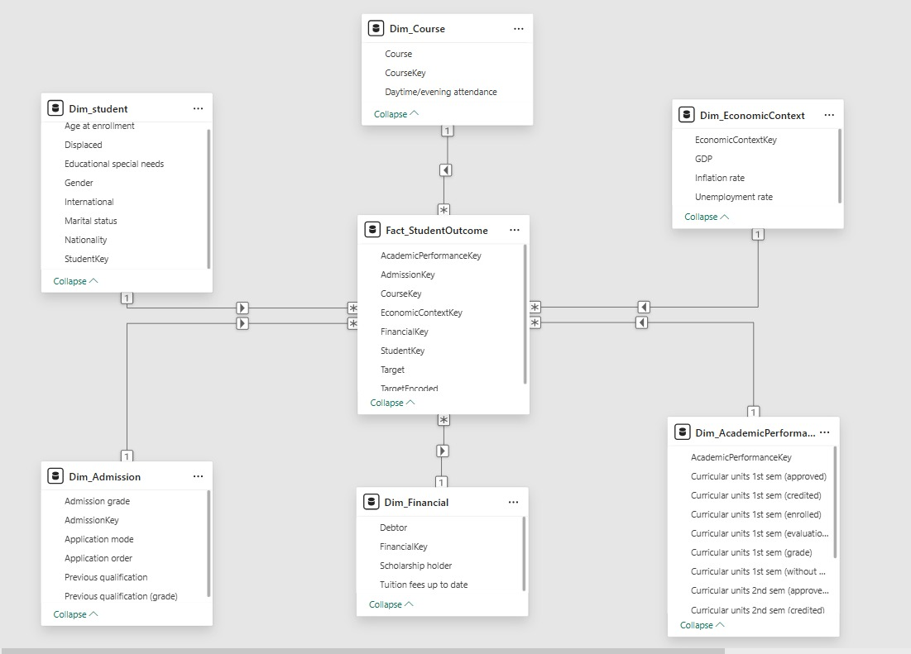

# Student Dropout and Academic Success

A data mining course project combining a Power BI data warehouse
with a Python comparison of 11 classifiers for student academic outcomes.

The project covers dataset exploration, Power Query transformations,
star-schema modeling, shared train/test preparation, model training,
and evaluation.

## Dataset

The project uses the UCI dataset
[Predict Students' Dropout and Academic Success](https://archive.ics.uci.edu/dataset/697/predict+students+dropout+and+academic+success).

- 4,424 student records.
- 36 original predictor features.
- Three target classes.

| Class | Encoded value | Records |
| --- | ---: | ---: |
| Dropout | 0 | 1,421 |
| Enrolled | 1 | 794 |
| Graduate | 2 | 2,209 |

Features include admission information, demographics, financial indicators,
academic performance, and economic context.

The experiments include first- and second-semester academic records.
The reported results therefore describe outcome prediction using those
records, rather than prediction at enrollment time.

## Workflow

1. Explore the original student dataset.
2. Clean and transform it in Power BI / Power Query.
3. Build a star-schema data warehouse.
4. Export the analytical flat table.
5. Prepare a shared stratified train/test split.
6. Train and evaluate model Pipelines.
7. Compare the saved evaluation results.

## Data Warehouse

The warehouse contains one fact table and six dimensions:

- Fact_StudentOutcome
- Dim_Student
- Dim_Admission
- Dim_Course
- Dim_Financial
- Dim_AcademicPerformance
- Dim_EconomicContext

The fact-table grain is one student record.

DWH surrogate keys are excluded from the machine-learning predictors.



The Power BI project is available at
[data/2_dwh/DWH_Phase_One.pbix](data/2_dwh/DWH_Phase_One.pbix).

## Experimental Setup

- Shared stratified 80/20 train/test split.
- Random seed: 42.
- Training records: 3,539.
- Test records: 885.
- 17 categorical/binary features and 19 numeric/ordinal/count features.
- One-hot encoding and numeric standardization inside model Pipelines.
- Five-fold training-set cross-validation for tuned experiments.
- Macro-F1 used for hyperparameter selection.
- No SMOTE or other external class resampling.

Logistic Regression and Gaussian Naive Bayes are untuned baselines.
The remaining nine models use the parameter searches defined in their
notebooks.

Logistic Regression, Decision Tree, Random Forest, and SVM use balanced
class weights.

The SVM experiment wraps the complete preprocessing Pipeline in
CalibratedClassifierCV, using three stratified folds for sigmoid
probability calibration.

Search spaces, class weighting, and model-specific procedures differ
between experiments. The comparison describes the evaluated configurations
on one shared held-out test split.

## Results

Models are ordered by test Macro-F1. Values below are percentages.

| Model | Accuracy | Macro-F1 | Dropout Recall |
| --- | ---: | ---: | ---: |
| SVM | 80.00 | 75.09 | 76.41 |
| XGBoost | 80.56 | 74.32 | 78.87 |
| LightGBM | 79.89 | 73.70 | 80.28 |
| Random Forest | 77.97 | 73.51 | 74.30 |
| Logistic Regression | 76.72 | 72.91 | 76.06 |
| CatBoost | 79.10 | 71.87 | 78.52 |
| Gradient Boosting | 77.97 | 70.73 | 76.06 |
| MLP | 72.99 | 66.59 | 76.41 |
| Decision Tree | 69.15 | 66.57 | 67.25 |
| KNN | 73.22 | 61.94 | 66.20 |
| Naive Bayes | 23.73 | 21.22 | 19.37 |

- SVM recorded the highest Macro-F1 and Balanced Accuracy.
- XGBoost recorded the highest Accuracy.
- LightGBM recorded the highest Dropout Recall.

Dropout Recall should be considered alongside Dropout Precision:
detecting more dropout cases can also produce more false alerts.

Full metrics, classification reports, confusion matrices, and tuning
summaries are stored in
[_03_Models/results/](./_03_Models/results/).

The final ranking is available in
[final_model_ranking_by_macro_f1.csv](./_03_Models/results/final_model_ranking_by_macro_f1.csv).

## Project Organization

| Path | Purpose |
| --- | --- |
| `_01_Dataset_Overview/` | Dataset exploration |
| `_02_Data_Cleaning_Preprocessing/` | Shared split and feature definitions |
| `_03_Models/` | Model notebooks and final comparison |
| `_03_Models/results/` | Evaluation tables and tuning summaries |
| `_03_Models/saved_models/` | Saved fitted models |
| `data/1_raw/` | Original extracted dataset |
| `data/2_dwh/` | Power BI project and warehouse exports |
| `data/3_ml_ready/` | Exported analytical flat table |
| `data/4_model_inputs/` | Shared training/test CSV files and metadata |
| `docs/images/` | Star-schema image |
| `requirements.txt` | Tested versions of the main Python dependencies |

## Python Setup

The reported experiments used Python 3.12.4 on Windows 11, 64-bit.

From the repository root, create an environment and install dependencies:

```powershell
py -3.12 -m venv .venv
.\.venv\Scripts\python.exe -m pip install -r requirements.txt
```

Open the repository root in VS Code and select the `.venv` environment
as the notebook kernel.

The dependency file pins the main libraries used for the experiments.
Exact numerical reproduction can depend on library versions and platform.

### Review Existing Results

Run:

```text
_03_Models/07_Final_Model_Comparison/12_final_model_comparison.ipynb
```

This reads the supplied result CSV files and generates comparison tables
and charts without retraining models.

### Reproduce Training

1. Run the dataset overview notebook if you want to inspect the raw data.
2. Run:
   `_02_Data_Cleaning_Preprocessing/02_powerbi_ml_ready_preprocessing.ipynb`
3. Run the individual model notebooks numbered 01–11.
4. Run the final comparison notebook numbered 12.

The preparation notebook checks existing train/test CSV files and preserves
them when they match the generated split.

The exported flat table is included, so Python experiments can run
without refreshing Power BI first.

Training notebooks save their results and fitted models using the
documented filenames. Running their save cells updates those files.

### Use a Saved Model

Saved `.joblib` models include fitted preprocessing.
The saved SVM model also includes probability calibration.

Run this example from the repository root:

```python
from pathlib import Path

import joblib
import pandas as pd

root = Path.cwd()

test_data = pd.read_csv(
    root / "data" / "4_model_inputs" / "test_clean.csv"
)

X = test_data.drop(columns="TargetEncoded").head(5)

model = joblib.load(
    root / "_03_Models" / "saved_models" / "svm_model.joblib"
)

predictions = model.predict(X)
probabilities = model.predict_proba(X)

print(predictions)
print(probabilities)
```

Pass a DataFrame containing the 36 original feature columns, using the
names in `train_clean.csv`. Encoding and scaling are applied by the
saved model.

## Power BI Setup

To refresh or inspect the warehouse in Power BI Desktop:

1. Open `data/2_dwh/DWH_Phase_One.pbix`.
2. Select **Transform data**.
3. Open **Manage Parameters**.
4. Set `ProjectRoot` to the absolute path of your repository folder,
   without a trailing backslash.
5. Refresh the queries, then select **Close & Apply**.

`ProjectRoot` is the folder containing `data/` and `_03_Models/`.

The raw-data query reads:

```text
data/1_raw/predict+students+dropout+and+academic+success/data.csv
```

The source CSV uses a semicolon delimiter and UTF-8 encoding.

## Reproducibility Notes

- LightGBM 4.6.0 with `n_jobs=1` was used for the completed experiment.
  LightGBM 4.7.0 produced an access-violation error in the tested
  Windows environment.
- On some Windows systems, Joblib may warn that physical-core detection
  failed and fall back to the logical-core count.
- Results reflect one dataset and one held-out split.
- The feature set includes second-semester performance, which determines
  the timing at which these predictions could be made.

## Dataset Attribution

Dataset creators: V. Realinho, M. Vieira Martins, J. Machado, and L. Baptista.

Source: UCI Machine Learning Repository.
Dataset DOI: https://doi.org/10.24432/C5MC89

The source dataset is distributed under
[CC BY 4.0](https://creativecommons.org/licenses/by/4.0/).

Project transformations include warehouse modeling, cleaned column names,
target encoding, and derived training/test tables.